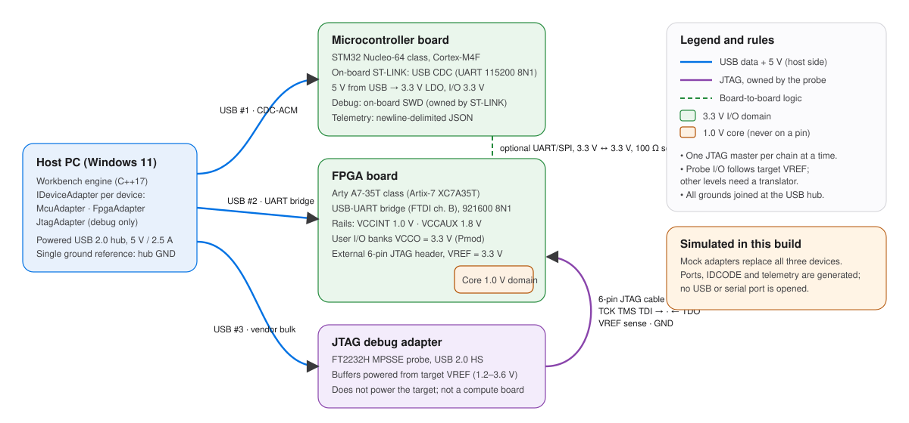

# Embedded-system integration design

A modular, host-connected bench with **one microcontroller board, one FPGA board
and one JTAG debug adapter**. The software side is implemented as C++ mock
adapters (`src/core/hardware/`). **Everything is simulated**: no wiring, firmware or
FPGA programming was carried out.



## 1. Device-specific assumptions

The design names concrete board *families* because pinouts and voltages are
board-specific. Nothing below assumes that the three devices share a connector,
voltage or protocol.

| Role | Assumed board | Why this kind |
|---|---|---|
| Microcontroller | STM32 Nucleo-64 class (e.g. NUCLEO-F446RE, Cortex-M4F) | On-board ST-LINK provides USB power, a virtual COM port and SWD, so one cable carries power, data and debug |
| FPGA | Digilent Arty A7-35T class (Xilinx Artix-7 XC7A35T) | On-board FTDI USB-UART, 3.3 V Pmod I/O, on-chip XADC for temperature and supply monitoring |
| JTAG adapter | FT2232H-based probe (MPSSE), 6-pin (VREF, GND, TCK, TMS, TDI, TDO) flying-lead or 2×7 2 mm cable | Common, open-source-supported probe (OpenOCD); buffers powered from target VREF |

If different boards are used, re-check §2 against their schematics before connecting anything.

## 2. Interface and pin/voltage table

| Interface | From → To | Signals | Voltage / level | Connector | Owner / notes |
|---|---|---|---|---|---|
| Host power | Powered USB hub → each board | VBUS, GND | 5 V, ≤ 500 mA per port (USB 2.0) | USB-A → board USB (Mini-B / Micro-B) | Hub with its own 5 V / 2.5 A supply so the three loads do not depend on laptop ports |
| MCU host link | Host ↔ ST-LINK (on board) | USB D+/D− → UART TX/RX to MCU | USB differential on the host side; 3.3 V UART on the board | USB Mini-B | CDC-ACM virtual COM, 115200 8N1, newline-delimited JSON |
| MCU supply | ST-LINK 5 V → on-board LDO | 3V3 | 3.3 V I/O; **pins are 5 V-tolerant only where the datasheet marks FT** | – | Never drive MCU pins from the 5 V rail |
| MCU debug | ST-LINK → MCU | SWDIO, SWCLK, NRST | 3.3 V | on-board | Owned by the on-board ST-LINK; the external JTAG probe is **not** connected to the MCU in this design |
| FPGA host link | Host ↔ FTDI channel B | USB → UART TX/RX | 3.3 V UART on board | USB Micro-B | 921600 8N1, framed binary telemetry |
| FPGA core rails | On-board regulators | VCCINT, VCCAUX, VCCO | 1.0 V, 1.8 V, 3.3 V | – | 1.0 V and 1.8 V are internal; only 3.3 V VCCO banks reach headers |
| FPGA JTAG | External probe → FPGA JTAG header | TCK, TMS, TDI → FPGA; TDO → probe; VREF; GND | Bank 0 / JTAG at 3.3 V; probe follows VREF | 6-pin 2.54 mm header | **One JTAG master per chain:** the board's own USB-JTAG (FTDI channel A) must be idle or disabled while the external probe drives the chain |
| JTAG probe host link | Host ↔ FT2232H | USB 2.0 HS bulk | – | USB | Vendor driver (WinUSB via Zadig, or FTDI D2XX) |
| MCU ↔ FPGA (optional) | MCU UART/SPI ↔ FPGA Pmod | TX/RX or SCK/MOSI/MISO/CS, GND | 3.3 V ↔ 3.3 V | Pmod 2×6 / Arduino header | Same level, so no translator; 100 Ω series resistors limit edge rates and protect against contention during configuration |
| Grounding | All boards | GND | 0 V | USB shields + JTAG GND | All grounds meet at the hub; the JTAG cable GND lead is connected **before** signal leads |

### Level shifting rules

- **MCU and FPGA, 3.3 V to 3.3 V:** no shifter; use series resistors.
- **JTAG:** the FT2232H probe buffers run from target VREF (1.2–3.6 V), so the probe adapts to the target. A target outside that range would need a dedicated translator such as a TXS0108E-class part. That translator would be unsuitable for strong pull-ups, so check its datasheet.
- **5 V peripherals,** if ever added: a unidirectional translator (e.g. 74LVC245 powered at 3.3 V for 5 V → 3.3 V inputs). Never connect them directly.

## 3. Why the JTAG adapter is not "another board"

A JTAG adapter is a **debug interface**. It drives the IEEE 1149.1 test access
port (TCK/TMS/TDI, reading TDO) of *another* device so the host can:

- read IDCODEs;
- control boundary scan;
- program the FPGA's configuration memory;
- halt and step a CPU.

It has no application logic, does not run user workloads, does not power the
target, and its electrical interface is defined by the target's VREF. Treating it
as an interchangeable compute board would be a category error. The software
design therefore uses capability lists rather than device kinds:

| Adapter | Capabilities |
|---|---|
| MCU | `telemetry.stream`, `gpio.*`, `adc.12bit`, `uart.115200` |
| FPGA | `telemetry.stream`, `xadc.*`, `clock.status`, `register.read` |
| JTAG | `jtag.scan_chain`, `jtag.idcode`, `jtag.tck_config`, `target.vref_sense` (no `telemetry.stream`) |

Its "telemetry" is link status: target VREF, TCK frequency, chain length and the
IDCODE found (Artix-7 XC7A35T, `0x0362D093`). A unit test asserts that only the
JTAG adapter reports scan-chain capability and that it does not stream telemetry.

## 4. Software design (implemented, simulated)

```
IDeviceAdapter (device.h)            info(), state(), connect(timeout), disconnect(), readTelemetry(timeout)
 └─ MockAdapterBase (mock_devices.h) seeded deterministic model + fault injection (none / timeout-once / timeout-always)
     ├─ MockMicrocontroller          die temperature, VDD, ADC channel, loop rate
     ├─ MockFpga                     XADC core temperature, VCCINT, VCCAUX, MMCM lock, fabric clock
     └─ MockJtagAdapter              target VREF, TCK frequency, chain length, IDCODE
DeviceManager (device_manager.h)     discovery, retry with exponential back-off, event log
```

- **Discovery** returns all three devices with model, transport, simulated port,
  firmware, I/O voltage and capabilities. Every record carries `simulated = true`,
  and the UI shows a *SIMULATED* badge on every card.
- **Connect** is retried up to 3 times, with a 250 ms timeout and back-off of 50 ms then 100 ms.
- **Recoverable failure (demonstrated in the UI):**
  - *Inject timeout*: the next request times out.
    - On connect, the automatic retry succeeds on attempt 2.
    - On telemetry, the device becomes *faulted* and **Recover** reconnects it.
  - *Unplug*: every request times out. The retries are exhausted, the error is
    logged, and the device stays faulted until the fault is cleared and the user reconnects.
- **State errors** (telemetry while disconnected) are reported separately from
  device faults (HTTP 409 vs 504), so a user mistake is not mistaken for a hardware fault.

## 5. Safe integration plan (for real hardware)

1. **Inspect before power:** read each board's schematic; confirm the VCCO of the
   FPGA bank used for JTAG and Pmods, and which MCU pins are FT (5 V-tolerant).
2. **Power one board at a time** from the powered hub. Check that it enumerates,
   that the 3.3 V rail measures 3.2–3.4 V, and that no part runs hot.
3. **Host links first, no inter-board wires:** replace each mock with a real
   adapter behind the same `IDeviceAdapter` interface (serial port for MCU/FPGA,
   libftdi/OpenOCD for JTAG) and run the same tests.
4. **JTAG:** with the FPGA board powered and its on-board JTAG idle, connect GND
   first, then VREF, then the signals. Start at TCK ≤ 1 MHz, read the IDCODE, and
   only then raise TCK (6 MHz assumed). Program volatile SRAM before flash.
5. **Optional MCU↔FPGA link:** add only after both work alone; series resistors in
   place; FPGA pins configured as inputs in the bitstream before the MCU drives them.
6. **Recovery:** every adapter must handle unplugging (timeouts, port loss) without
   hanging the UI. The mock fault injection exercises exactly this path.

## 6. Limitations

- No physical wiring, PCB, firmware or bitstream was produced or tested.
- Voltages and pinouts are taken from the named board families' typical
  configuration and must be verified against the actual board revision.
- Mock timeouts return immediately instead of blocking for the timeout period, so
  the UI stays responsive. A real adapter would block a worker thread, not the UI.
- Discovery is fixed: three devices, always present. Real enumeration (USB VID/PID
  matching, serial port scanning) is not implemented.
